# A8 – Gears

## Objective
The objective of this assignment is to design a gearbox that can be assembled and taken apart while making sure the shafts and journal bearings are strong enough for the required loads. I also have to design a housing with proper clearance and fastening so everything fits together correctly. Using calculations and parametric modeling in SolidWorks, I will need to work on creating a final design and document my calculations, sketches, and lessons learned.
## Input Shaft
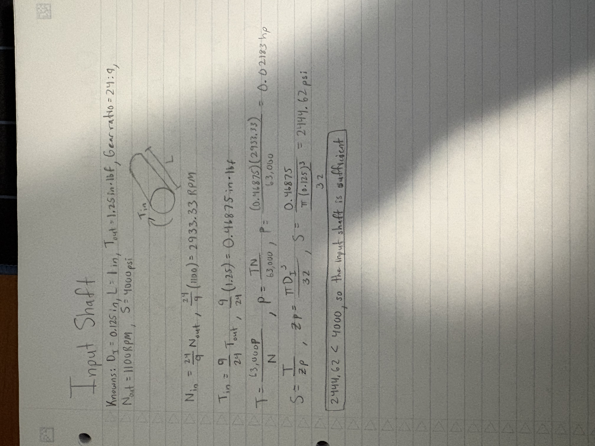
For the input shaft, I used the given gear ratio, output speed, and torque to calculate the input speed, torque, and power. I then calculated the maximum shear stress using the shaft diameter to make sure the shaft could handle the applied torque. Finally, I compared the stress to the allowable stress to check if the shaft was strong enough for the design.

## Output Shaft
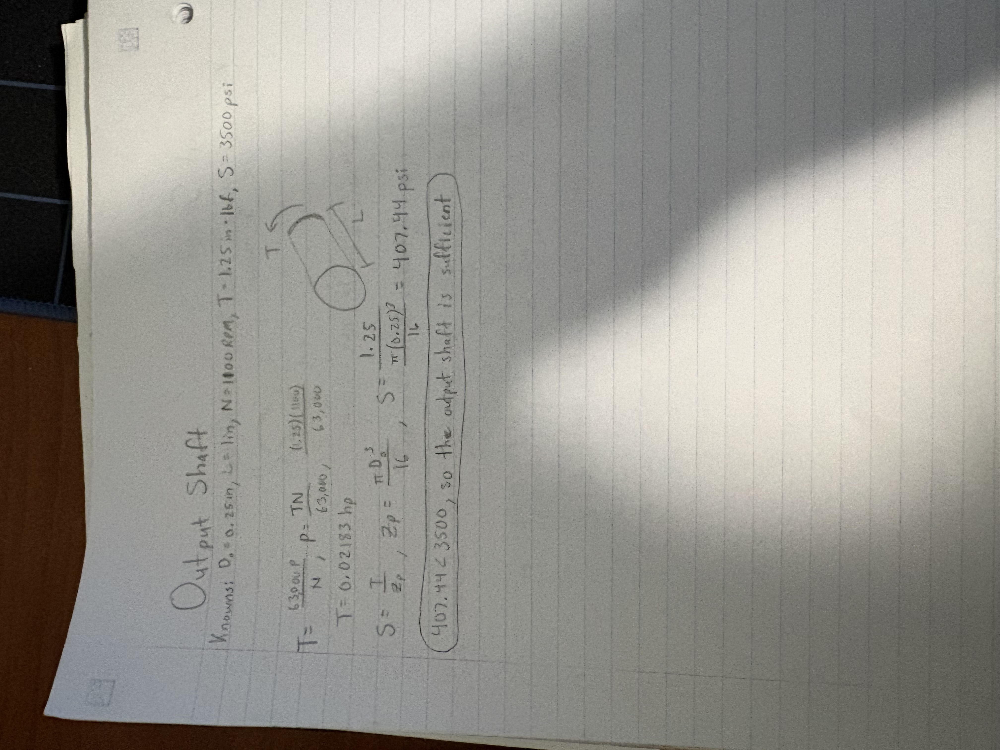
For the output shaft, I used the given torque, rotational speed, and shaft diameter to calculate the power and maximum shear stress. I then compared the calculated stress to the allowable stress to make sure the shaft could handle the torque without failing. This helped me determine if the output shaft was strong enough for the gearbox design.

## Journal Bearing
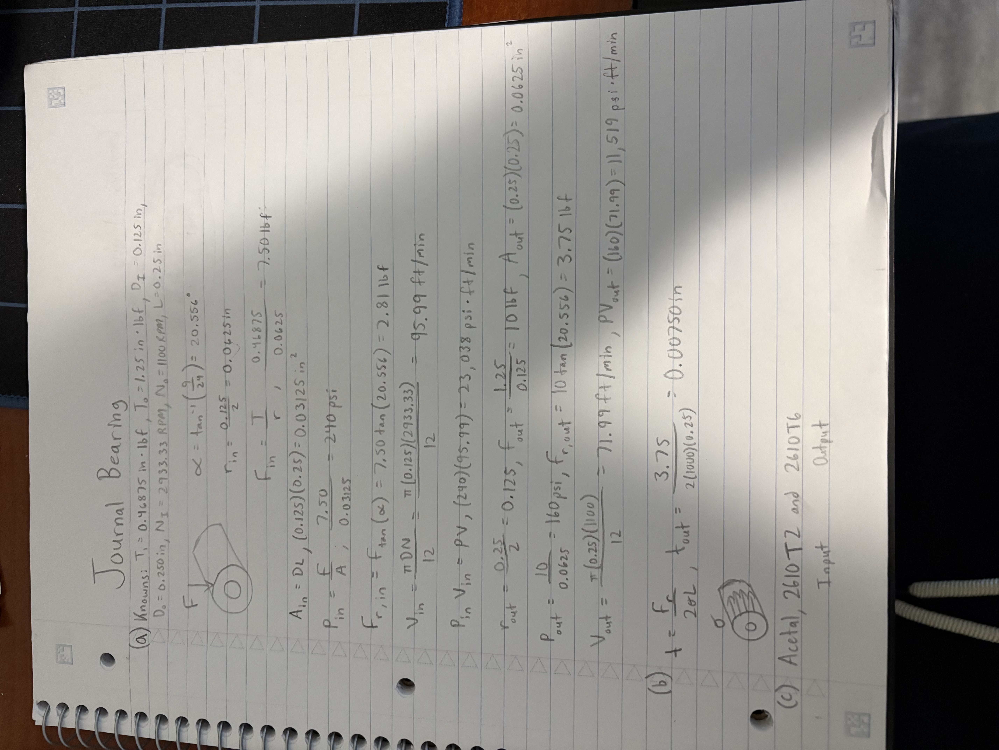
For the journal bearings, I calculated the bearing pressure, surface velocity, and PV value to make sure the bearings could support the shafts properly. I also looked at the bearing dimensions and material to help choose suitable bearings for the gearbox. This helped me determine what bearings to use and how they would fit into the overall design.

## Gearbox Housing Sketch
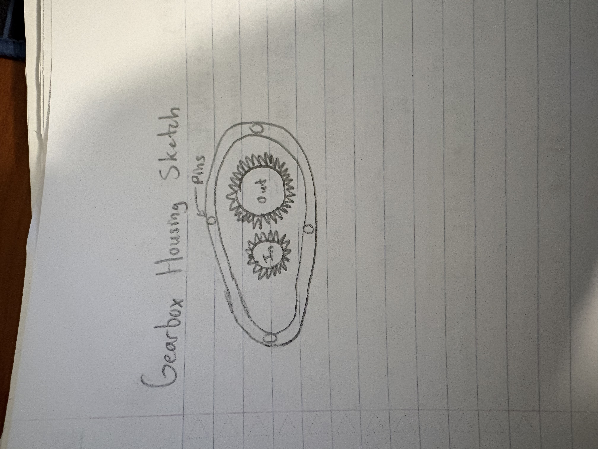
For the gearbox housing sketch, I used my gear and shaft dimensions to plan out a housing that would fit everything together properly. I included enough clearance for the gears and space for the journal bearings, along with a way to fasten the housing together. This gave me a starting point for creating the final gearbox design in SolidWorks.

## CAD on Gearbox Housing
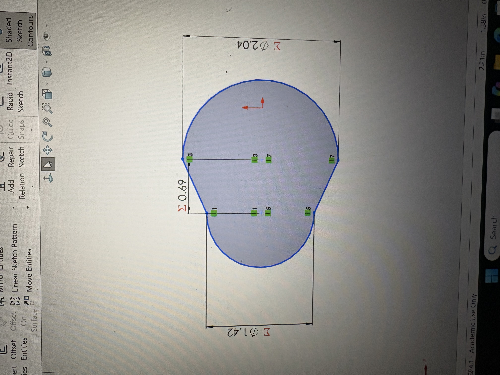
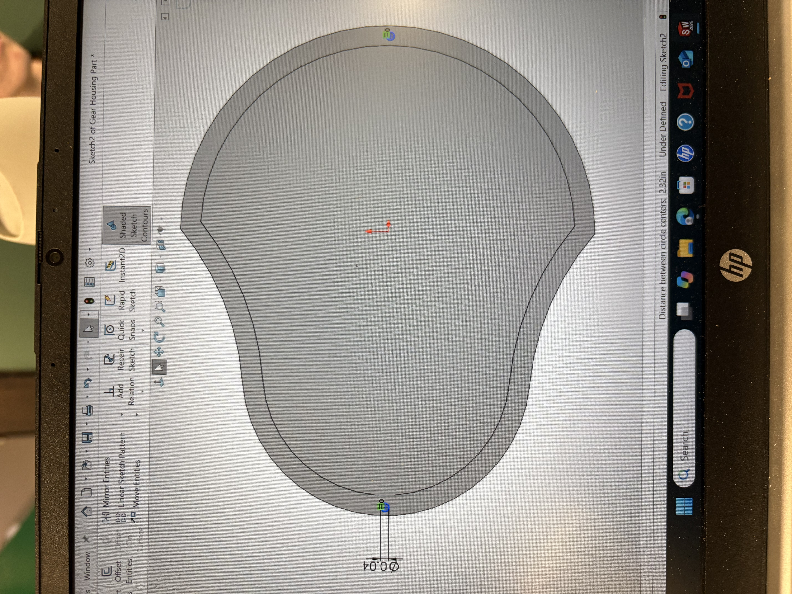
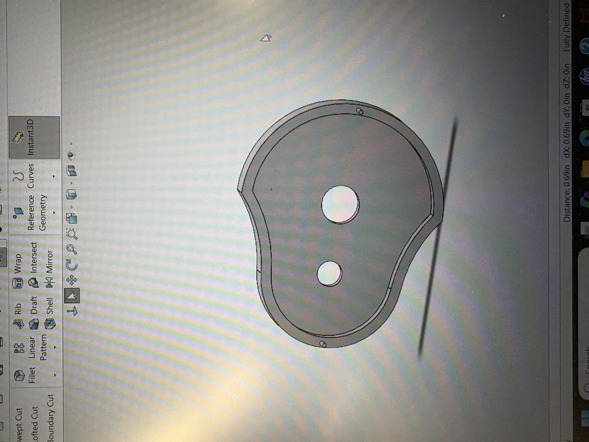
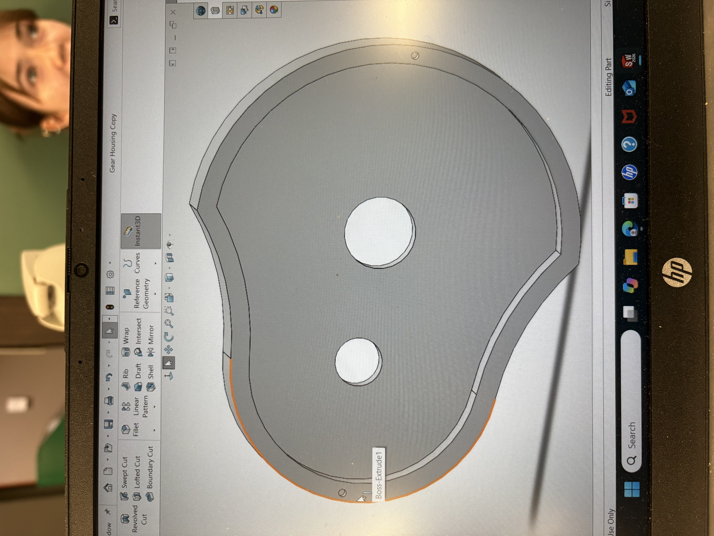
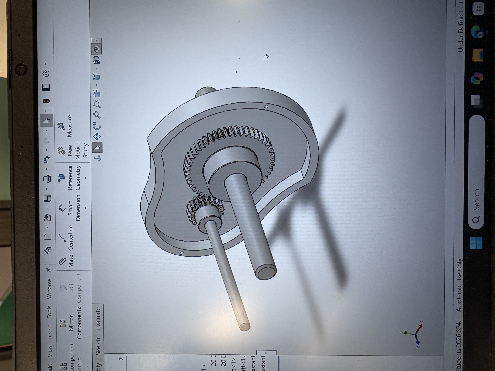
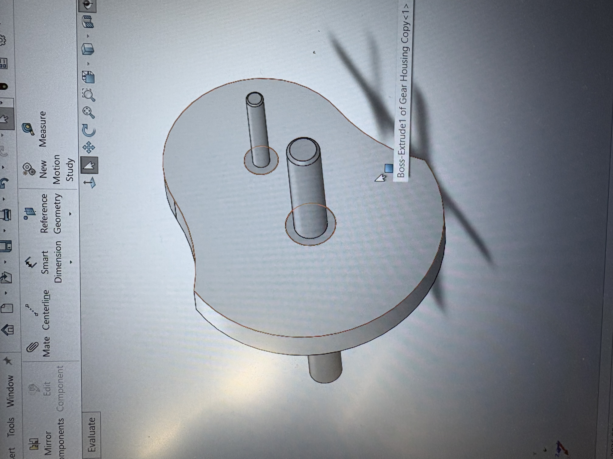
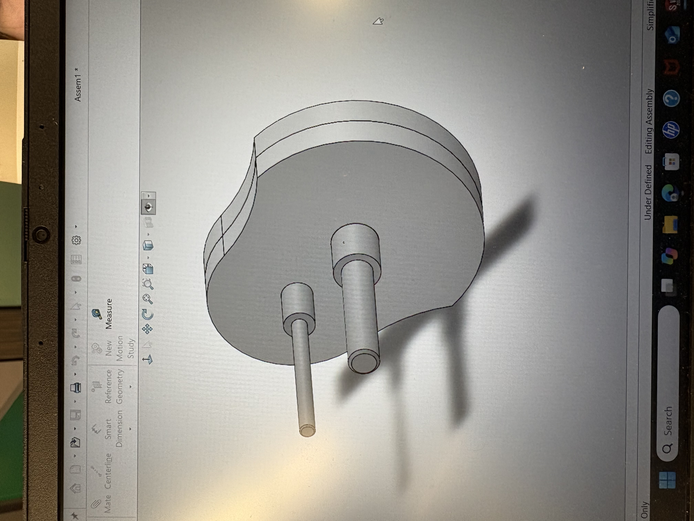
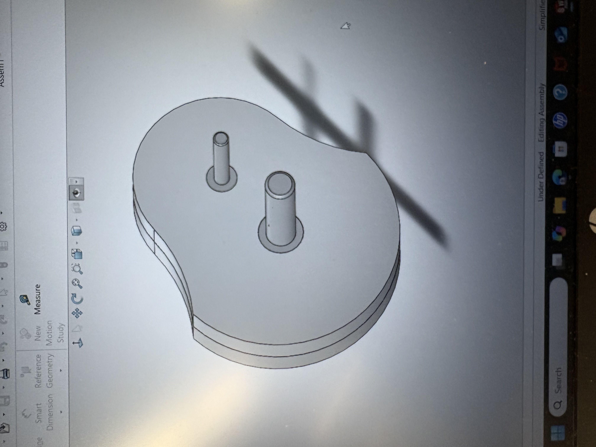
For the CAD of my gearbox housing, I was able to successfully design one. I started with getting the proper dimensions and extruding by my thicknesses. I then created two pin holes and made a copy so the other case could conjoin with the other. I then assembled all my gears, sleeves, and shafts from the links. I used the mate technique to join them together, and the gears were able to move along with one another in the end.

## Engineering Lessons Learned
One of the biggest things I learned from this assignment was how to use calculations to make sure the shafts and journal bearings could handle the required loads. I also learned how important it is to leave enough clearance between the gears and housing, so everything fits and works together properly. Overall, this assignment helped me get better at using SolidWorks and showed me how important it is to check my calculations and dimensions before finishing a design. 

## CAD Work Downloads and 2157 Drawings
I made six drawings for my two shafts, two gearbox housings, and two plain bearings, along with an assembly drawing of the whole gearbox. I made sure my drawings followed ASME Y14.5 standards and used third-angle projection.

[Download my SolidWorks Case](https://github.com/awayne1-eng/megr2157-portfolio/blob/main/docs/assignments/A08/Gear%20Housing%20Part%20Case.SLDPRT)

[Download my SolidWorks Case Copy](https://github.com/awayne1-eng/megr2157-portfolio/blob/main/docs/assignments/A08/Gear%20Housing%20Copy.SLDPRT)

[Download my SolidWorks Case Copy](Assembly for A8.SLDASM)

