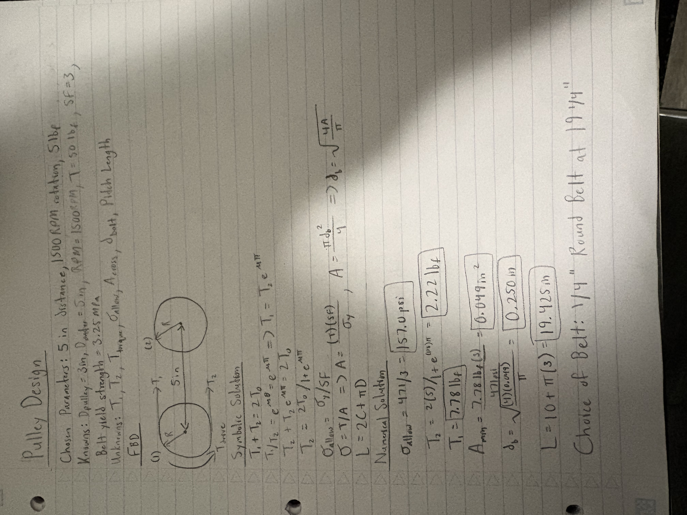
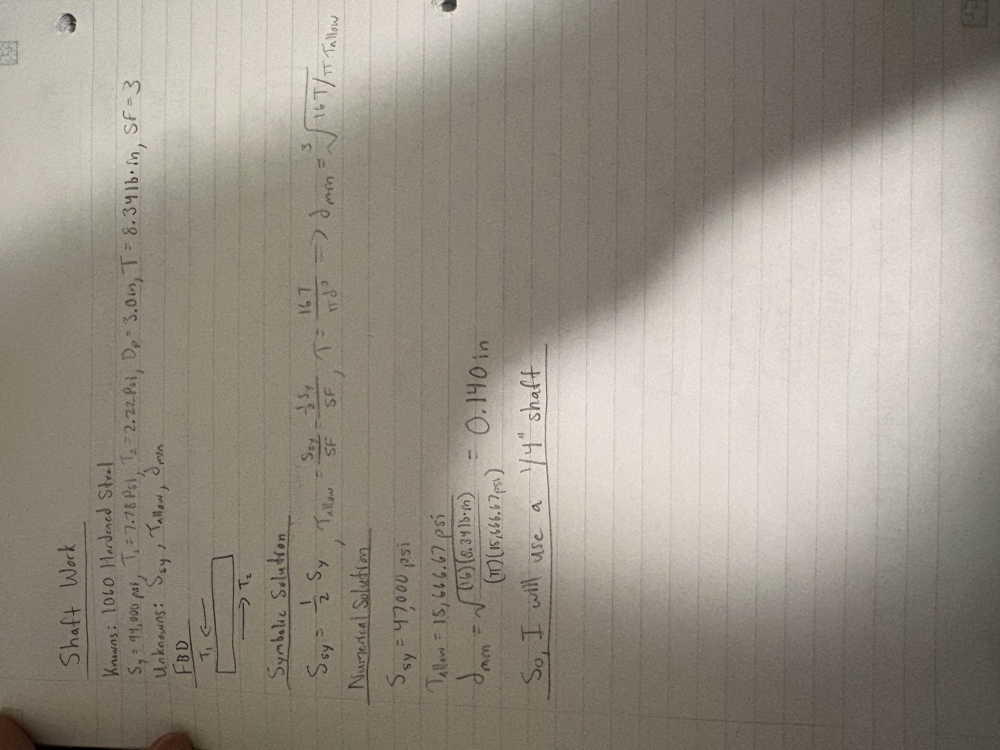
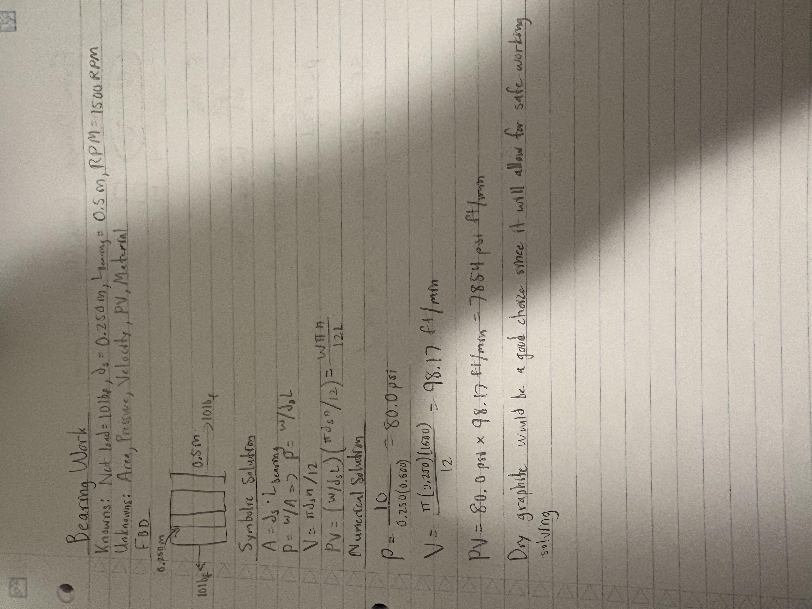
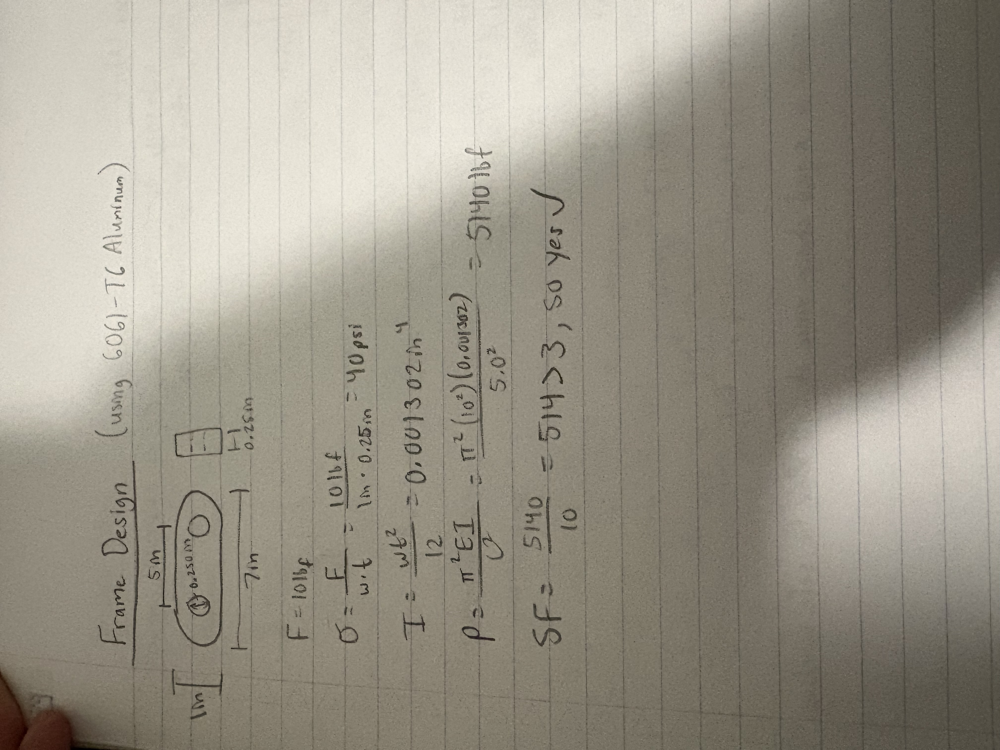

# A9 – Pulleys

## Objective
This project moves away from the CAD design portion of the course and focuses more on the mathematical design of a pulley system. The pulleys must be spaced between 4–6 inches apart, operate at a rotational speed of 1,000–2,000 RPM, and maintain a belt tension of 4–6 lbf. We also have specific material requirements to follow and must use a safety factor of 3. The main goal of this project is to apply engineering calculations to determine the proper dimensions and values while making sure everything falls within the required limits. Throughout the process, we also need to show our calculations, explain our design decisions, and document any challenges or problems that come up along the way.

## Pulley Design

## Shaft Work

## Bearing Work

## Frame Design

## Decide

## Communicate

